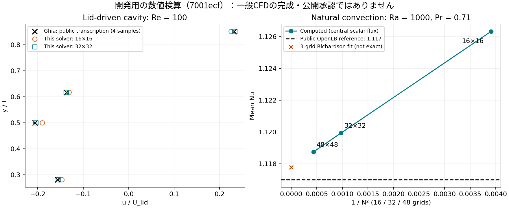

# 開発用2D CFD：方程式・参照・未完了

2026-11-04。dynamic/dev/cavity.mjsは公開allowlistに入れない。矩形・閉領域の2D非圧縮Navier–Stokesと移流拡散の開発実装で、現在は初期の数値確認段階。従来の相関式計算や、1D発達流路の近似と混同しない。一般形状CFD、流入/流出、乱流、固体との連成、UI/Workerとの結合は未実装。

## 数値系

速度を面、圧力/温度をセル中心に置くMAC格子。保存型の運動量流束と粘性拡散を前進Eulerで予測し、Neumann圧力Poisson方程式を平均ゼロの前処理付きCGで解いて速度を投影する。圧力は相対値で絶対圧力ではない。圧力L2残差と速度発散の最大値は別物。閉壁の法線速度は0、接線のno-slip/lidは壁のghost値で指定。CG非収束で元の状態を変更しない。

温度の面流束は隣接セルで等量逆符号に計上。壁温条件は半セルの熱抵抗、上下面は断熱。熱の収支は顕熱と境界熱量のみで、粘性散逸の発熱/圧縮仕事を含む完全な全エネルギー方程式とはしない。浮力は基準密度を除いたgβ(T−Tref)を鉛直運動量に加えるBoussinesq近似。|βΔT|≤0.1を保守的な監視範囲とし、普遍的な精度保証とはしない。

移流は初期の風上形と、セルPe≤2を確認する中心形を比較。風上形の人工拡散によるNuの差を記録し、見た目に合わせて熱流を調節しない。中心形が範囲を超えた場合は停止し、無断で別の物理モデルへ変えない。開発用入力はlid Re≤100、自然対流Ra≤1000に限定。自由形状や未知の移流方式を黙って無視しない。

## 参照と出所

- Ghia, Ghia, Shin (1982), DOI 10.1016/0021-9991(82)90058-4。公開転記 https://gist.githubusercontent.com/ivan-pi/3e9326d18a366ffe6a8e5bfda6353219/raw/3694c1ae997e670098fb1f186bee3bd122ab236f/ghiau.txt のTable I、Re100の4点だけを対照した。例えばx=0.5,y=0.5のu/U_lid=-0.20581。原論文の全表や他Reの転記精度を承認した結果ではない。
- de Vahl Davis (1983), DOI 10.1002/fld.1650030305。OpenLBの公開例 https://github.com/openLB/openLB/blob/ffe45d9722e5dc7317e6e9bd9cfb46812e630a1f/examples/thermal/squareCavity2d/squareCavity2d.cpp にPr=0.71、Ra1000の参照Nu=1.117と記載される。よく引用される1.118との差もあり、原論文該当表の直接照合は未完了。比較値を原論文から直接確認済みと書かない。

公開転記/参照実装から利用したのは比較用の数値事実と条件だけ。CFDコードは独立実装し、OpenLB等の実装をコピーしていない。原論文の図表/文章や外部コードを配信物へ複製しない。

## 計測と許容値の意味

scripts/dynamic-cavity-benchmarks.mjsが再現手順。局所の製造速度場を投影して発散を除く試験、静止/一様温度、圧力非収束の原子性、閉熱収支、入力範囲の拒否もtests/dynamic-cavity.test.mjsにある。

- lid Re100：16/32格子、t=30で中心u≈−0.189722/−0.203945。32格子の公開参照4点に対する最大誤差は約0.0021（lid速度1で正規化）。t20→30の中心変化は約9.4e−7、時間刻み半分のt30中心差は約6e−11。定常値の時間刻み依存が小さいことの確認であり、過渡全体の高次時間精度の証明ではない。
- 自然対流Ra1000/Pr0.71：16/32格子で中心移流形のNu≈1.126319/1.119943。風上形では≈1.157549/1.135291。数値拡散の差を隠さない。
- 発散は代表的に1e−10程度、顕熱収支誤差は1e−11程度以下。これらと格子誤差/圧力残差/モデル誤差を混同しない。

初期の回帰ゲートは正規化uの絶対差0.005、Nuの差0.006、速度発散1e−8、顕熱収支1e−8。格子16→32の改善も要求する。uは粗格子/補間誤差、Nuは格子誤差に加えて参照の丸め/転記差を含む、教育用の初期確認の予算である。これだけで工学的完成と承認しない。格子3段階、局所壁面量/圧力/速度分布全体、独立基準のさらなる照合、過渡精度、ブラウザー実操作/長時間安定性等は後続の公開ゲート。

検証用定数は無次元条件を再現する数学的な仮定値で、実在流体の物性データとしてプリセット化しない。流体の実物性・SI条件への対応はアプリへの結合時に別途検証する。計測時間はクラウドCPUの実測で、同時に別の検証を走らせた場合もあり、スマートフォン/GPU性能を主張しない。

## 状態

CFD_BENCHMARKS_20261104.jsonはローカル開発ツリーでの計測（入力ガード追加前）として保存。最新の保存SHAの検査は専用CIの実行ログへ追跡し、過去結果へ置き換えない。現実装はUIへ公開しない。Claude Codeによる独立再監査に、参照値の元資料照合・圧力境界・時間/格子誤差と保存則の再計算を引き継ぐ。

独自に作成した初期の比較図：

再生成は `python3 scripts/plot-dynamic-cfd-benchmarks.py`。これは開発時の図生成だけに使い、Webアプリ利用者へPython等を要求しない。

## 圧力の密度スケール

圧力反復はp/ρで解き、速度補正の後にρを掛けて物理的なゲージ圧力へ戻す。これにより同じ速度の製造場で密度の尺度だけを変えても、速度解と連続の式の誤差が変わらない。旧方式ではρ=1e−18という数学的な尺度試験で、絶対残差判定のため反復0回・発散約3.00となった。修正後はρ=1e−18/1e−10/1000でρ=1と同じ速度、圧力はρ倍となることを検査。これは数値的な尺度不変性の試験で、真空中の連続体モデルが妥当という意味ではない。

圧力Poissonの残差/RHSノルムはこの正規化したp/ρに対する値で、物理圧力のPaや速度発散の1/sと混同しない。ρ=1の既存キャビティ対照では数値演算が同じとなるが、新保存SHAのCIでも再計算する。

## 自然対流の第3格子（追加測定）

48×48、中心移流形、t=1の平均Nu=1.118748501478649、最大発散1.53113e−11、顕熱収支誤差7.09531e−13 J。計測ソースc4db4fa。t=0.5から1のNu変化は約3.05e−7。16/32の既存記録と非等比細分化で先頭誤差C h^pを当てはめるとp≈1.98099、外挿Nu≈1.1177797。ただし単一の壁面平均量・3点の近似であり、全場の精度や漸近領域を証明しない。原論文の参照値の差をこの外挿で決着させない。

記録はCFD_FINE_GRID_20261104.json。粗格子は過去の別計測で、同じ最新SHAで全格子を実行した結果とは区別する。rho=1では密度正規化による演算は変わらないが、正式な再現は `node scripts/dynamic-cavity-benchmarks.mjs --full` で行う。このオプションへ自然対流48格子を追加した。通常CIは16/32格子の回帰を維持する。48格子はクラウドCPUで約458秒（他の検証との同時実行を含む）であり、端末性能の主張ではない。局所量・速度圧力全場・境界/形状・実機・連成などの公開ゲートは依然未完了。

再計算の記録を失わないよう、各ケースの完了を標準エラーへ逐次記録し、最終JSONにsourceCommitを加えた。専用CIは --fullで同じSHAの3格子と半時間刻みを実行し、最終JSONのartifactを30日保持する。途中で中断したローカルの空ファイルを検証結果として採用しない。fullの追加ゲートは3格子の変化が同じ向きで差が減ること。観測次数/外挿は単一の平均Nuの診断量で、専門家校閲や全場誤差の代わりではない。

## 保存済み同一SHAでの拡張再現完了

7001ecfd96911693581ceb42554f759734c900e1、push CI41846561947/job126631480323で --fullが成功。結果はCFD_FULL_REPRODUCTION_20261104.json。artifactのローカル取得は403だったため、成功した実行ログから最終JSONを取得しsourceCommitとpassedを確認して保存した。pull_request CI41846571089（合成マージSHA0401ddb85e385e60b14134cebf0428d9c46f216c）も4ジョブ成功だが、数値記録の主な根拠はpush側の実ソースSHAとする。

自然対流のNuは16/32/48格子で1.1263186929272706 / 1.1199427644339721 / 1.118748501478649、単一平均量の観測次数1.9809900212、外挿1.1177797015。48格子の最大発散1.53113e−11、熱量収支7.09531e−13 J。lid32格子の半時間刻み中心速度−0.2039447617003824。CIの計算時間は約714秒（クラウドCPU）で、利用者端末の性能ではない。これで同じ保存ソースの3格子/半刻みの記録ができた。局所量・速度/圧力全場・一次文献照合・境界/一般形状・ブラウザー結合・専門家校閲は未完了で、CFDを公開ビルドへ入れない方針は維持する。比較図もこの同一SHAの値から再生成した。
